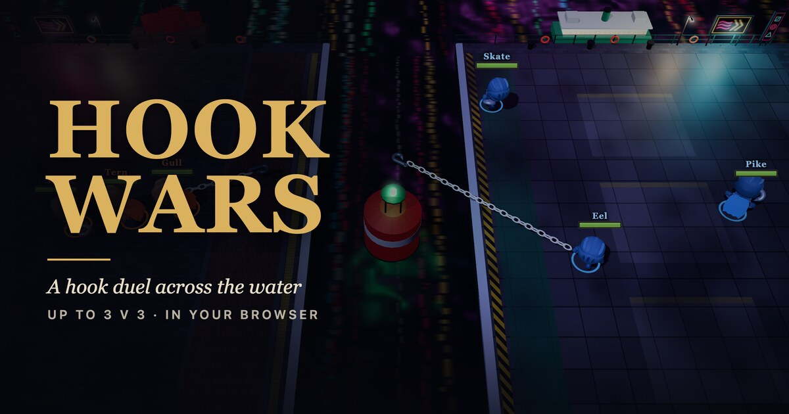

# Hook Wars

A hook duel across the water, in the browser. Two teams stand on opposite banks, throw hooks across the gap, and drag each other over to finish the fight up close. Play alone against bots or online with friends, up to 3 v 3.

**Play it: <https://hook-wars.fly.dev>**



Hook Wars is an original game inspired by the Warcraft III custom map Pudge Wars. It borrows the idea of the mechanic and nothing else: the name, characters, art and code are its own. The in-game credits page thanks the map's authors.

## How to play

| Action | Keys |
|---|---|
| Move | `W` `A` `S` `D` or the arrow keys |
| Throw the hook at the cursor | `Space`, or click |
| Grapple to the cursor | `E` (after buying the grapple) |
| Buy an upgrade or item | `1` to `6` |
| Scoreboard | hold `Tab` |
| Menu | `Esc` |

- A hook that lands deals damage and drags its target back to you. The target is staggered for a moment when set down, so the thrower gets the first blow.
- Next to an enemy, your fighter swings the hook on its own. You cannot swing while your hook is out.
- Kills and assists pay gold, and so does time. Spend it on hook damage, range, speed and size, on a grapple that pulls you across the water, or on a barb that lets a returning hook catch.
- With fog of war on, you see an enemy only when someone on your side is close enough.
- First side to the kill target wins.

## Run it locally

You need Node 24 and pnpm 11.

```sh
pnpm install
pnpm dev            # single player, http://localhost:5183
pnpm dev:online     # the page plus a game server, for rooms
```

For online play, open the page, choose "Create a room", and open the link it gives you in a second browser window.

Useful query switches for the page: `?roster=3v3` starts a match straight away, `?scene=victoria|golden-gate|daan|harbour` picks a scene, `?fog=on` turns fog on, `?opponent=idle` swaps the enemy for a practice dummy, `?gold=2000` starts rich.

## Check your changes

```sh
pnpm typecheck
pnpm test           # unit tests, all packages
pnpm build
pnpm e2e            # browser tests for single player; needs no server
pnpm e2e:online     # browser tests for rooms; starts its own server
```

Run the two browser suites one after the other. They render WebGL in software and time out when they compete for the machine.

## How it is put together

The rules never touch the screen. They are pure functions that take a state and inputs and return the next state, so the same code runs in the browser for single player and on the server for rooms.

| Package | What it is |
|---|---|
| `packages/sim` | The rules of a match: `step(state, inputs, dt)`, bots, gold, upgrades, grapple, fog of war. Deterministic, no DOM. |
| `packages/room` | The lobby as a reducer: who sits where, the settings, whether a match may start. |
| `packages/protocol` | Every message between browser and server, as zod schemas. Nothing crosses the wire unparsed. |
| `apps/server` | One Node service (Hono and `ws`). It serves the built page and runs every room, authoritatively, at 30 ticks a second. |
| `apps/client` | Vite and React for the menu, lobby and HUD; Three.js for the scene. It draws only the view its team is entitled to. |

Online, the browser sends intents and the server decides everything. The local fighter's walk is predicted and reconciled against the server; everything else is interpolated a little in the past. Under fog of war the server never sends a client what its team cannot see.

## Deploy

The live site runs as one small machine on Fly.io. [`DEPLOY.md`](DEPLOY.md) has the steps, the settings and what to watch.

Rooms live in that machine's memory, so there is exactly one machine, and a deploy closes every room.

## Credits

- Inspired by Pudge Wars, a Warcraft III custom map, and the people who built and maintained it. The in-game credits page lists them.
- Character and dungeon models are from the KayKit packs by Kay Lousberg (<https://www.kaylousberg.com>), released under CC0. Their licence files are in `apps/client/public/assets/kaykit/`.
- The Victoria Harbour, Golden Gate and Daan Forest Park scenes are generated in code and use no third-party assets.

Hook Wars is an unofficial fan project. It is not affiliated with or endorsed by Blizzard Entertainment, Valve, or the authors of the original map, and uses none of their art, audio or code.
